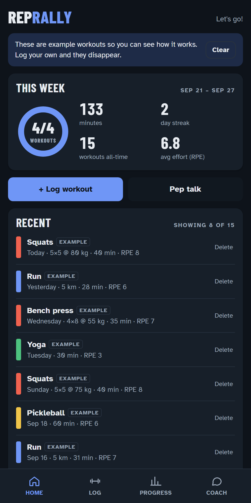
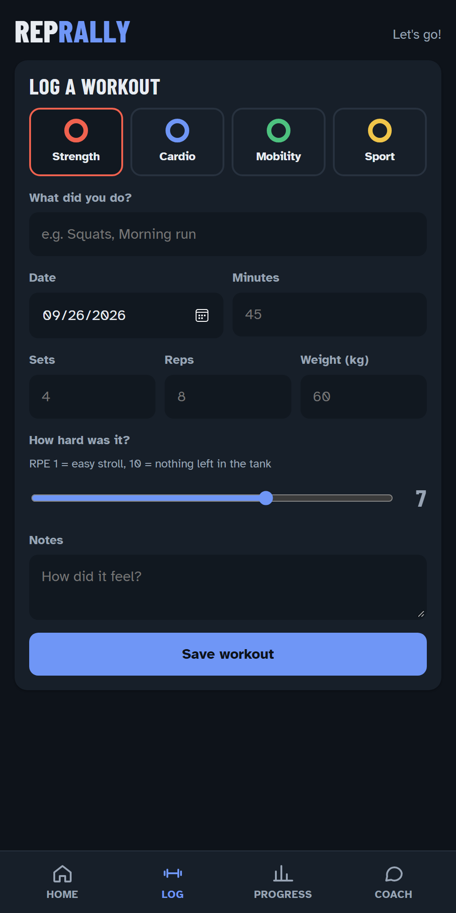
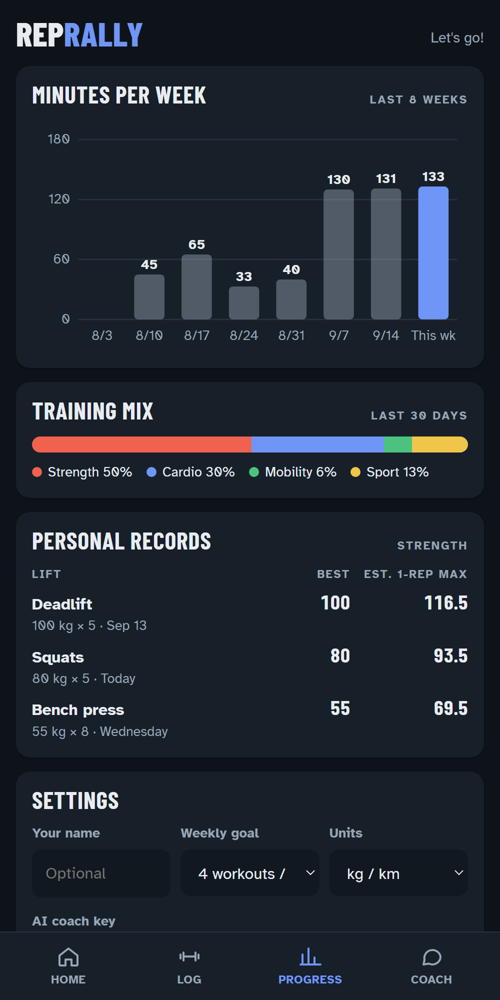

# Rep Rally

A phone-first workout tracker with weekly goals, streaks, progress charts, personal records and an AI coach powered by Claude.

**Live demo:** `https://CosmicShadow.github.io/rep-rally/` *(available once GitHub Pages is enabled; see [Deploy](#deploy))*

<p>
  
  
  
</p>

## Features

- **Log workouts in seconds.** Pick a type (Strength, Cardio, Mobility or Sport), then add sets, reps, weight, distance, duration and effort on the 1–10 RPE scale.
- **See the week at a glance.** A goal ring, total minutes, your current day streak and average effort.
- **Track progress.** An 8-week minutes chart, a 30-day training mix, and personal records with an estimated 1-rep max (Epley formula).
- **Chat with an AI coach.** It reads your recent training and answers questions, plans your next session or hypes you up. Choose a *Cheerleader* or *Drill sergeant* style. Replies stream in as they're written.
- **Works offline and privately.** No accounts and no backend. Data stays in the browser's `localStorage`. Without an API key, the coach falls back to built-in pep lines.
- **Built for phones.** Bottom tab bar, large tap targets, safe-area insets, light and dark themes, and reduced-motion support.

## Tech

| | |
|---|---|
| Frontend | Vanilla HTML, CSS and JavaScript. No framework and no build step. |
| Charts | Hand-drawn SVG |
| AI | [Anthropic Messages API](https://docs.claude.com/en/api/messages), called directly from the browser with streaming Server-Sent Events |
| Tests | Node's built-in test runner (`node --test`), zero dependencies |
| CI/CD | GitHub Actions runs the tests, then deploys to GitHub Pages |

```
index.html        App shell and markup for the four tabs
css/styles.css    Design tokens, light/dark themes, layout
js/stats.js       Pure date and stats logic (streaks, weekly totals, PRs, 1RM)
js/coach.js       Prompt building, SSE stream parser, Messages API client
js/storage.js     localStorage persistence and example data
js/app.js         UI rendering and event handling
tests/            Unit tests for stats and coach logic
scripts/serve.js  Tiny static server for local development
```

`stats.js` and `coach.js` don't touch the DOM, so the same files run in the browser and in Node tests. The coach tests use a fake `fetch` that streams SSE in small chunks, which covers text assembly, refusals, HTTP errors and mid-stream failures.

## Run it locally

You need [Node.js](https://nodejs.org) 18 or newer.

```bash
npm start
```

Then open http://localhost:5173. To run the tests:

```bash
npm test
```

## Turn on the AI coach

1. Create an API key at [console.anthropic.com](https://console.anthropic.com/settings/keys).
2. In the app, open **Progress → Settings** and paste the key into **AI coach key**.
3. Optionally choose a model: Claude Opus 5 (default), Sonnet 5, or Haiku 4.5 for faster, cheaper replies.

**About the key:** it's saved only in your browser's `localStorage` and sent only to `api.anthropic.com`. The request uses Anthropic's `anthropic-dangerous-direct-browser-access` header, which allows calls from a web page. This bring-your-own-key design suits a personal or demo app. For a public product, put the key behind a small server so users never handle it. API usage is billed to the key's owner.

## Deploy

The included workflow publishes the site to GitHub Pages on every push to `main`.

1. Push this project to a GitHub repository.
2. In the repo, go to **Settings → Pages** and set **Source** to **GitHub Actions**.
3. Push again, or run the **Deploy to GitHub Pages** workflow from the **Actions** tab.

## Roadmap ideas

- Shared family leaderboard and weekly challenges (needs a backend)
- Export and import workouts as CSV
- Installable PWA with an offline service worker
- Server-side proxy for the AI coach

## License

[MIT](LICENSE)
